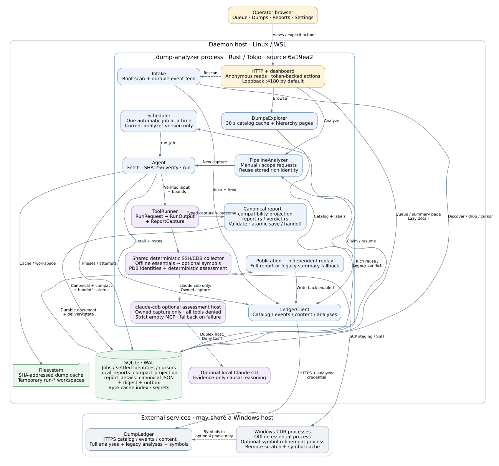
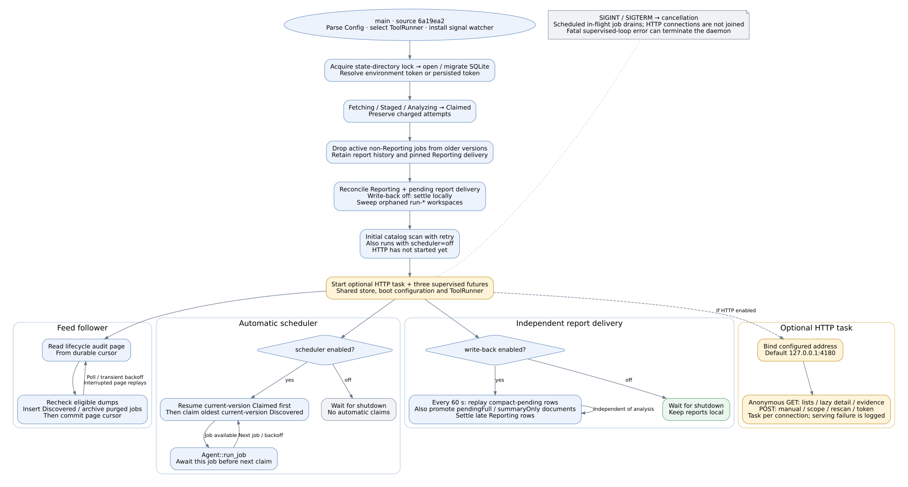
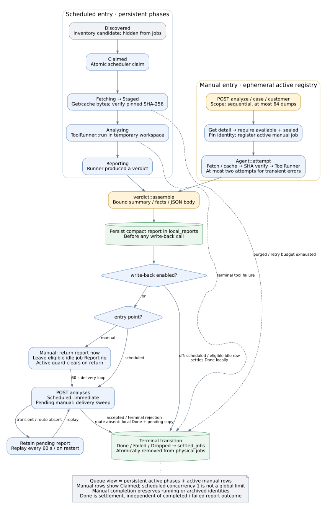
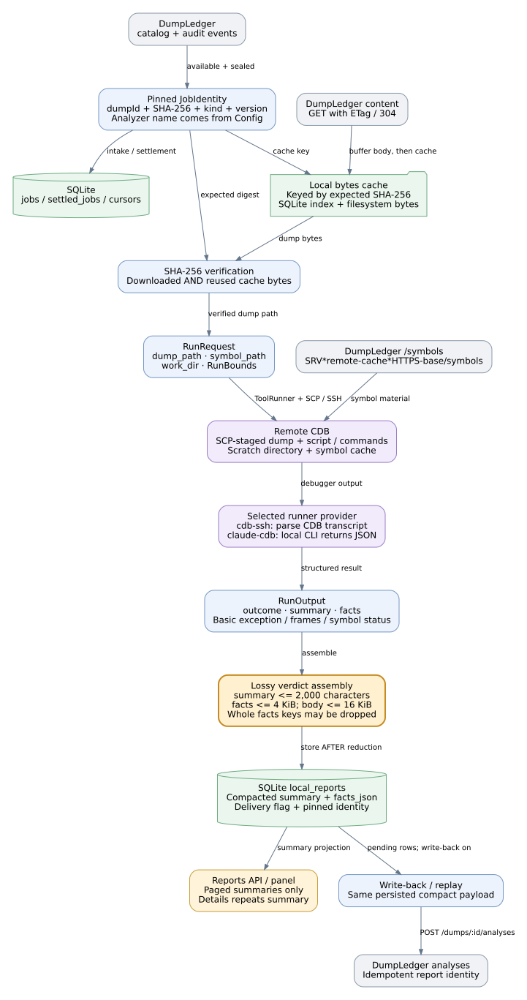
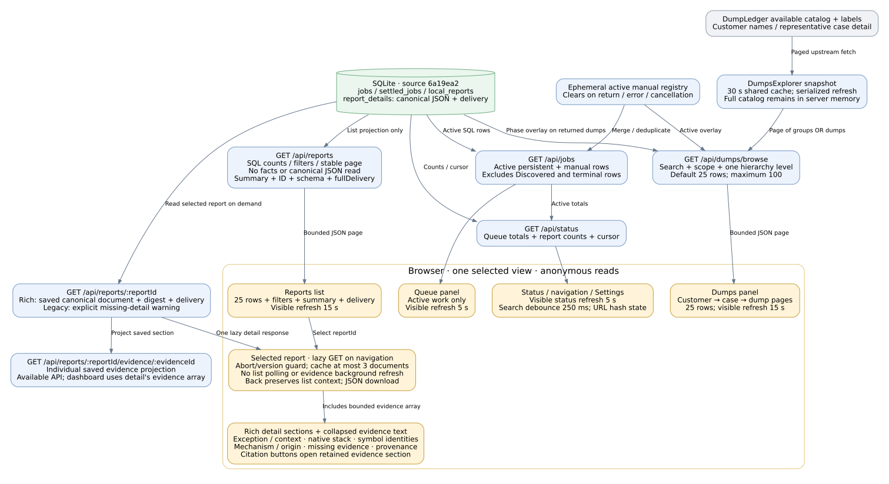

# DumpAnalyzer architecture

**Current providers:** `cdb-ssh` and `dsh-http`. The `claude-cdb` provider was removed on 2026-10-26; the diagrams below retain the inspected 2026-10-20 architecture. See [current provider configuration](../README.md#tool-runner-providers).

Source revision: `6a19ea297bb219509c994780c96bdd6ce6c4bfab` · inspected 2026-10-20.

These diagrams describe the implemented source at the revision above. They show logical process and storage boundaries, rather than asserting a live deployment configuration. Open [the rendered diagrams](architecture.html) for zoom controls. The report contract is described in [rich reports](rich-reports.md); historical canary evidence is kept separately in [the qualification record](../tests/fixtures/report-v2/qualification/README.md).

DumpAnalyzer discovers sealed dumps from DumpLedger, verifies their bytes, executes deterministic CDB collection on a configured Windows host, and saves a canonical forensic report locally. Symbol refinement and evidence-only Claude reasoning are optional stages. The daemon can publish full reports to DumpLedger, fall back to a compact summary for older servers, and retain full evidence locally for later delivery. Its dashboard offers a queue, customer/case dump browsing, report detail and manual actions.

## 1. Runtime block diagram



Blue blocks are Rust components; purple blocks are runner providers or their subprocesses; green blocks are durable local storage; amber blocks are operator interfaces; gray blocks are external services. Rust components share one process and SQLite store. Several components own separate `LedgerClient` instances built from the same boot configuration.

DumpLedger supplies catalog metadata, audit events, dump bytes and symbols, and stores submitted reports. DumpAnalyzer owns execution and local evidence. CDB runs on the configured Windows SSH target; DumpLedger may share that physical host. Both runner choices use the same deterministic CDB collector. With `claude-cdb`, a local Claude CLI receives the owned capture afterward and proposes an assessment; it does not drive CDB.

| Component | Responsibility and implementation |
| --- | --- |
| Entry point / configuration | Parse configuration, select `cdb-ssh` or `claude-cdb`, install signal handling: [main.rs][main], [config.rs][config]. |
| Scheduler / intake | Lock and migrate state, recover jobs, scan catalog, supervise feed, scheduling and delivery: [scheduler.rs][boot], [sync.rs][scan]. |
| Agent / manual facade | Scheduled phases and shared verified-input attempt machinery: [agent.rs][scheduled]. On-demand analysis, existing-report reuse, scope batches and active registry: [analyzer.rs][manual]. |
| Typed runner / collection | `RunRequest`, `RunOutput` and `ToolRunner`: [types.rs][runner-types]. Mandatory offline collection, optional symbol refinement and PDB qualification: [runner.rs][collect]. |
| Assessment | Deterministic evidence rule and validation: [assessment.rs][assessment]. Optional evidence-only duplex Claude host: [claude_runner.rs][reasoner]. |
| Canonical report / persistence | `ReportCapture`, `CrashReportV2`, validation and compact binding: [report.rs][capture]. Atomic canonical report, compact projection and queue handoff: [state.rs][save-rich]. |
| Publication / replay | Full submission, legacy fallback and independent full-delivery outbox: [verdict.rs][publish], [verdict.rs][replay]. |
| Dashboard / explorer | Anonymous read projections and token-backed actions: [http.rs][http-routes]. Cached catalog hierarchy: [explorer.rs][browse]. Lazy report detail: [dashboard.html][detail-load]. |

The default listener is `127.0.0.1:4180`; an empty `DUMP_ANALYZER_HTTP_ADDR` disables HTTP. Reads, including report detail and evidence, are anonymous. An action without an Authorization header can use the daemon's stored token, so this token mechanism does not authenticate individual callers of an exposed listener. A supplied bearer token must match the stored token. Storing a token first probes DumpLedger, then updates the local secret and UI action checks; existing pipeline clients retain their boot-time credential until restart. See [HTTP authorization][authorization] and [token storage][store-token].

The state lock excludes another process using the same state directory. It does not enforce unique analyzer attribution across different directories or hosts; single-writer use of an analyzer name/version remains an operational requirement. See [state locking][state-lock].

## 2. Daemon control flow



Boot acquires the state-directory lock, opens/migrates SQLite, resolves the credential, recovers volatile jobs, retires active execution from older analyzer versions, reconciles reporting/delivery, and sweeps orphaned `run-*` workspaces. The initial catalog scan completes before HTTP starts, so an unavailable catalog can delay the dashboard. Discovery runs even with automatic scheduling disabled.

After boot, the feed follower, automatic scheduler and report-delivery loop advance independently under the supervisor. HTTP is a separately spawned task. The feed applies a page's events before committing its cursor; an interruption replays the page. Automatic scheduling resumes `Claimed` work for the current version before claiming the oldest current-version `Discovered` row, then awaits one scheduled job before claiming another. Delivery sweeps every 60 seconds, even while analysis is busy or automatic scheduling is off.

| Configuration | Effect |
| --- | --- |
| `DUMP_ANALYZER_SCHEDULER=off` | Stops automatic claims; intake, browsing, manual analysis and enabled delivery remain available. |
| `DUMP_ANALYZER_WRITE_BACK=off` | Stores reports locally and settles eligible jobs without posting; dump and symbol reads remain in use. Replay is disabled. |
| `DUMP_ANALYZER_HTTP_ADDR=''` | Disables HTTP; daemon loops still run. |
| `DUMP_ANALYZER_RUNNER` | Chooses deterministic `cdb-ssh` or deterministic collection plus optional `claude-cdb` assessment at boot. |
| `DUMP_ANALYZER_VERSION` | Pins new job/report identity. The default is package version `0.2.0`; legacy `0.1.0` is rejected. A distinct version permits a new capture without overwriting an old identity. |

On restart, `Fetching`, `Staged` and `Analyzing` reset to `Claimed`, preserving attempts. Active non-`Reporting` rows from older versions are dropped; report history is retained. Old `Reporting` rows retain their version for reconciliation/delivery. Scheduler claims are restricted to the configured version. SIGINT/SIGTERM cancels the loops, with the scheduler observing cancellation between jobs and draining its current job. HTTP connection tasks are not joined by that guarantee. A serving failure is logged without terminating the pipeline; fatal supervised-loop errors can terminate it.

Sources: [boot and retirement][boot], [supervised futures][supervisor], [current-version scheduling][schedule-loop], [delivery cadence][delivery-loop], [recovery][recovery], [feed cursor ordering][feed], [version configuration][version].

## 3. Job and manual-request control flow



Scheduled execution persists `Discovered → Claimed → Fetching → Staged → Analyzing → Reporting`. It verifies the pinned SHA-256 before invoking the runner, and allows at most two charged transient failures. The canonical report, digest-bound compact projection and scheduled `Reporting` handoff are committed together before publication. A parsed report with outcome `failed` is still a report to save and deliver; transport or runner failure can instead terminate the job without one.

The synchronous manual path first requires an available dump with a sealed hash and pins `(dumpId, inputSha256, triage, configuredVersion)`. If a rich report already exists for that identity and analyzer name, it returns its stored compact projection without another runner execution. A different stored analyzer name is an integrity conflict. A legacy compact row using the identity blocks rich reanalysis until a distinct version is selected. Rich and compact documents are immutable for an identity; concurrent differing captures can therefore conflict instead of replacing saved evidence.

New manual runs use the Agent's fetch/verify/runner machinery without persisting intermediate phases. Their temporary registry entry displays `Claimed` and clears on return, failure or cancellation. The final transaction saves canonical evidence, compact projection and the eligible idle-job handoff. It preserves running scheduled rows and archived terminal identities. With write-back enabled the request returns the stored projection while the independent delivery loop publishes it; with write-back off an eligible idle row settles locally. Scope requests accept at most 64 dumps, process them sequentially and report individual failures as skipped items.

Three queue rules matter:

1. **Discovered is inventory.** It is an automatic scheduling candidate, hidden from the Jobs view. The Dumps explorer independently browses the available catalog, including previously analyzed dumps.
2. **Jobs means active work.** The API merges persistent `Claimed`, `Fetching`, `Staged`, `Analyzing` and `Reporting` rows with active manual requests, deduplicating identities for display.
3. **Terminal transitions archive identity.** `Done`, `Failed` and `Dropped` move atomically to `settled_jobs` and leave the physical queue. Ordinary discovery does not enqueue that settled identity again.

`Done` describes lifecycle settlement, independently of report execution outcome and full-delivery state. Missing publication routes can settle locally while retaining pending delivery. Automatic concurrency of one is not a global runner limit: separate manual requests can overlap the scheduler and each other. Manual duplicate exclusion belongs to the manual registry, rather than a shared scheduler/manual lock.

Sources: [scheduled execution and handoff][scheduled], [manual gates, reuse and save][manual], [scope limit][scope], [atomic report handoff][handoff], [terminal archive][terminal], [queue merge][queue].

## 4. Analysis and report data flow



The local `JobIdentity` is `(dumpId, inputSha256, kind, analyzerVersion)`; configured analyzer name completes the canonical and remote report identity. Bytes are cached by expected SHA-256 and verified before execution, including cache reuse following `304`. Downloads buffer the content body before writing the cache. The filesystem holds dump bytes and temporary workspaces; SQLite holds their index and durable metadata. See [identity and runner types][runner-types], [fetch/cache verification][fetch] and [symbol path construction][symbol-path].

The deterministic collector has two CDB phases:

1. **Mandatory offline essential collection.** CDB receives `-y` pointing to the per-run directory, containing the dump and scripts, without an HTTP symbol store. Marked sections capture target information, `.exr -1`, `.ecxr`/registers, fault-site disassembly, a preliminary native stack and initial modules. Parsing produces owned `ReportCapture` evidence before optional network symbol work.
2. **Optional symbol refinement.** A second CDB process sets the configured symbol path, reloads symbols, records detailed modules and obtains a final stack within the remaining time/output budget. Failure, timeout or no final stack retains preliminary evidence and records omissions. Successful refinement classified `Completed` upgrades an offline `Failed` baseline caused by missing symbols; refinement failure leaves the baseline outcome intact. Open/corrupt-dump markers remain failure evidence. After refinement, the collector reads expected minidump ModuleList/RSDS identities, probes loaded PDB Info-stream GUID/age with bounded read-only commands, and applies symbol quality.

The symbol path normally uses `SRV*<remote-cache>*<ledger-base>/symbols`. A debugger label or function name alone does not establish `matched`: canonical validation requires equal expected/loaded PDB identities and captured references. Frame symbol resolution and unwind reliability are separate fields. See [collector ordering][collect], [essential and refinement scripts][scripts], [refinement outcome upgrade][upgrade], [independent PDB qualification][pdb-probe] and [report validation][report-validation].

`RunOutput` includes optional typed `ReportCapture` alongside outcome, summary and compatibility facts. The capture owns provenance, exception record, saved context/registers/instruction, native stack, module/PDB quality, causal assessment, command evidence and completeness omissions. `CrashReportV2` adds schema version, stable report ID and full report identity. Legacy runner output without a capture is adapted with explicit missing-evidence limitations.

Deterministic assessment can confirm only the narrow immediate mechanism implemented in the source: a saved exception-context, register-indirect `mov` read whose register value equals the AV target and whose evidence is present and untruncated. It leaves the underlying cause unknown. No independently verified origin rule is implemented; validation rejects a confirmed root cause or a claimed origin rule. With `claude-cdb`, the collector runs first and the optional local Claude host receives only the owned capture. Tools are disabled, MCP configuration is empty and strict, hooks/settings sources are disabled, and every control-protocol tool request is denied. Accepted proposals must cite retained evidence and pass the same assessment validation; the deterministic immediate mechanism is preserved. Reasoning failure records an omission and retains deterministic evidence and assessment. See [assessment rule and validation][assessment], [reasoner isolation][reasoner] and [reasoner fallback][reasoner-run].

Canonical report validation limits the document to 512 KiB, 128 frames, 64 modules, 32 evidence sections and 8 KiB text per evidence section, with valid evidence references and canonical address strings. Collection also uses bounded transcript buffers (configured output cap, with a 4 MiB ceiling). These limits and recorded omissions apply to the retained capture. There is no durable full-transcript store. The local workspace is removed after a runner attempt; remote scratch cleanup is best effort under a separate cleanup deadline. Killing a local SSH process on timeout is not proof that its remote CDB child has terminated. See [limits][report-limits], [runner budget/cleanup][run-bounds] and [SSH timeout handling][ssh-timeout].

`prepare_report` builds validated canonical JSON and its SHA-256 digest, derives a small compatibility projection, then commits canonical JSON/digest in `report_details`, the compact row in `local_reports`, initial full-delivery state and eligible job handoff in one SQLite transaction. The compact projection carries `schemaVersion`, `reportId` and `reportDigest`; only this projection passes through the legacy 4 KiB facts / 16 KiB envelope limits and summary shrinker. The canonical summary itself is capped at 2,000 characters; its typed evidence does not pass through the legacy shrinker. Conflicting content for an existing identity is rejected. See [preparation][prepare], [compact binding][projection] and [transaction][save-rich].

Full publication uses the persisted canonical document. An unsupported rich route falls back to the bound compact summary. Summary acceptance never claims that the remote store has the full evidence, and `summaryOnly` reports remain eligible for later promotion. The durable full-delivery outbox is the `report_details.full_delivery` state plus its stored document; it is independent of the legacy `local_reports.posted` bit:

| State | Meaning |
| --- | --- |
| `localOnly` | Stored locally with write-back disabled; not selected by the full-delivery sweep. |
| `pendingFull` | Full report awaits delivery. |
| `summaryOnly` | Compact fallback was accepted; full evidence remains local and can be retried. |
| `fullyDelivered` | Full-report submission was acknowledged. |
| `abandoned` | Full delivery was permanently abandoned; local evidence remains. |

The legacy `posted` bit is compatibility bookkeeping and can also mark permanently abandoned submissions. Execution outcome, queue settlement, compact-summary bookkeeping and full-delivery state must therefore be read separately. See [delivery states][delivery-states], [full/legacy publication][publish] and [independent replay/promotion][replay].

## 5. Dashboard data flow and information load



The browser loads one list panel at a time. Visible-page status and Queue refresh every 5 seconds; Dumps and Reports lists refresh every 15 seconds while visible. Search is debounced by 250 ms. Navigation preserves panel, scope, filters, page and selected report in the URL hash. Browsing and opening report detail do not start analysis.

| View | Data source and boundary |
| --- | --- |
| Queue | Active SQL phases plus ephemeral manual registry; discovered and terminal rows are excluded. This active-work response is not a paginated catalog. |
| Dumps | Available DumpLedger catalog and customer/case labels → shared 30-second daemon snapshot → a page of customers, cases or dumps. Current local and manual phases overlay returned dump rows. |
| Reports list | SQL counts and stable filtered page of `ReportListRow`; the query neither reads nor deserializes canonical JSON or facts. Rows include ID, schema, detail availability, summary and full-delivery state. |
| Report detail | Selecting an ID lazily requests `GET /api/reports/:reportId`. Rich detail includes the saved canonical report, digest and delivery state; legacy detail explicitly says detailed sections were not captured. |
| Evidence | The detail response includes its bounded evidence array; native `<details>` sections disclose command text on demand and citation buttons open the referenced section. `GET /api/reports/:reportId/evidence/:evidenceId` also provides an individual evidence projection; the dashboard does not separately fetch each section. |
| Status / Settings | Lightweight daemon/count information, configuration, token storage, manual actions, rescan and diagnostics. |

Reports and explorer APIs default to 25 rows and cap page size at 100; the dashboard requests/renders 25. Customer/case groups contain counts instead of nested descendant lists. The explorer still holds the full catalog snapshot in server memory, and legacy `/api/dumps` still exposes that complete snapshot; the dashboard uses `/api/dumps/browse`.

Report detail stops list polling, uses an abort/version guard to reject stale responses, and retains at most three selected documents in a browser cache. There is no background evidence refresh. Returning to the list restores its navigation context. The UI presents capture status, exception/context, native frames, symbol identity, mechanism versus origin, missing evidence, provenance and delivery; missing values remain explicit.

Sources: [explorer paging/cache][browse], [summary-only SQL page][report-page], [detail/evidence routes][http-routes], [JSON projections][report-json], [detail rendering][detail-render], [lazy request/cache][detail-load], [polling][polling].

## 6. Qualification boundaries

The architecture was established by source inspection, rather than a deployment probe. The preserved [2026-10-15 canary record][qualification] establishes matching and deliberately mismatched PDB behavior, a controlled immediate null-read mechanism, isolated full-report round-trip/replay/restart, browser detail and migration of a private database copy for that recorded run. Its receipt revisions and artifact identities remain historical. They do not qualify every subsequent code change or unrelated customer dumps. The corrected live reasoner remained unrun in that record; fake-host checks and fallback evidence alone do not establish a successful live call.

A subsequent, explicitly authorized [2026-10-20 reasoner qualification](qualification/live-reasoner-2026-10-20/README.md) at source/test checkout `f269ce82d2ac28e9ba77f7f393ffc231e639a164` passed the ignored live test through the configured gateway `https://claude.jlcops.com/api/` (1/1, 16.45 seconds). Claude CLI `2.1.300` used configured alias `opus` but reported model **`deepseek-flash`**. Nine original evidence entries and deterministic captured sections/mechanism/completeness were preserved, with one accepted model assessment added; the underlying cause remained `unknown`. Offline controls passed 10/10, preservation checks 21/21 and independent review 20/20. No live denial challenge or instrumented request counter was recorded. This closes the configured CLI/gateway reasoner subgate only: it does not qualify an Anthropic Claude model, complete P6 rollout, or establish current CDB/SSH acquisition, service deployment or DumpLedger delivery. The initial official Anthropic endpoint attempt failed with `Not logged in` and yielded no accepted assessment.

A later [2026-10-20 production rollout checkpoint](qualification/production-rollout-2026-10-20/README.md) passed the deployment substep: the rebuilt local analyzer (application source `f269ce8`, PID `495042`, binary SHA-256 `cc284ecacd1f03d5ed4e5ae8b9659e082139d7b94e2135eb78ccc4088d5541ff`) retained its five rich reports and prior state, and the Windows companion moved from `69eb3d3` to `7c2a51b51d2638c462778c17fe9421632297b236`, excluding later WH1 work. The analyzer retained `cdb-ssh`, scheduler-off and write-back-off settings. Companion migration 9 added rich-detail storage after migration 10 was already present; prior table hashes/counts and database integrity were preserved. Authenticated v2 capabilities passed with validated TLS; this is a capability check, not a full-report acknowledgement.

At that deployment checkpoint, production publication/readback/restart qualification and full P6 remained open. Automatic approval review had rejected the real single-report publication because the exact crash payload/destination lacked explicit authorization; approval was then pending. The rejected action did not execute or create remote analysis detail: `analysis_details` remained 0 and `analyses` remained 33. No new CDB/SSH acquisition or model run was performed for that deployment checkpoint. Its separate receipt retains those observations and the build/test identities, backups and process/port state.

The user subsequently explicitly approved the exact selected report and destination. The [completed production canary](qualification/production-canary-2026-10-20/README.md) accepted `analysis_06F9B90BAB5F449199FA9C9C93`, returned that same ID on replay and preserved the exact 63,438-byte report on authenticated readback and publisher-store reopen (SHA-256 `d2ed241e0b7b36f0b6b4bf8cc355673ac910399ffb7cd90488f08fe27a85f2cb`). Before and after native backend restart, authenticated detail GET returned 200 and unauthenticated access 401; exact report/ID, compact v1 listing and prior analyses were preserved. The separate publisher store recorded `fullyDelivered`.

The native backend restarted as PID `51868` on ports `4081`/`4082`, with proxy PID `63648` unchanged. All ten post-canary table hashes matched before/after restart. Old rows stayed unchanged; only one row each was added to `dump_analyses` (33 → 34), `analysis_details` (0 → 1) and `audit_events` (941 → 942), with 128 dumps, 20 customers and 18 cases unchanged. Post-canary online and stopped backups were saved; no database restore was performed. **P6 production rollout and the bounded selected-report canary are complete at this checkpoint.** The main live analyzer retains five canonical reports under its unchanged `localOnly` policy, with global write-back and scheduling off and `cdb-ssh` retained. No new CDB/model run, broader automatic publication or additional causal proof is implied.

The architecture makes no claim of complete transcript preservation, remote child termination on local timeout, or an implemented confirmed-origin rule. Those limits follow the current code and remain separate from the historical canary's successful checks.

## Diagram sources

Graphviz sources and generated SVGs are in [docs/architecture/](architecture/). Regenerate the SVGs and this document's self-contained HTML view with:

```sh
python3 docs/architecture/render.py
wslview docs/architecture.html
```

Rendering requires Graphviz `dot` and Python's `markdown-it-py`. It does not build or run DumpAnalyzer. The HTML contains inline SVGs, zoom controls and source links pinned to the inspected revision.

[main]: https://github.com/NzSN/DumpAnalyzer/blob/6a19ea297bb219509c994780c96bdd6ce6c4bfab/src/main.rs#L26
[config]: https://github.com/NzSN/DumpAnalyzer/blob/6a19ea297bb219509c994780c96bdd6ce6c4bfab/src/config.rs#L192
[boot]: https://github.com/NzSN/DumpAnalyzer/blob/6a19ea297bb219509c994780c96bdd6ce6c4bfab/src/scheduler.rs#L110
[scan]: https://github.com/NzSN/DumpAnalyzer/blob/6a19ea297bb219509c994780c96bdd6ce6c4bfab/src/sync.rs#L192
[scheduled]: https://github.com/NzSN/DumpAnalyzer/blob/6a19ea297bb219509c994780c96bdd6ce6c4bfab/src/agent.rs#L213
[manual]: https://github.com/NzSN/DumpAnalyzer/blob/6a19ea297bb219509c994780c96bdd6ce6c4bfab/src/analyzer.rs#L275
[runner-types]: https://github.com/NzSN/DumpAnalyzer/blob/6a19ea297bb219509c994780c96bdd6ce6c4bfab/src/types.rs#L82
[collect]: https://github.com/NzSN/DumpAnalyzer/blob/6a19ea297bb219509c994780c96bdd6ce6c4bfab/src/runner.rs#L1420
[assessment]: https://github.com/NzSN/DumpAnalyzer/blob/6a19ea297bb219509c994780c96bdd6ce6c4bfab/src/assessment.rs#L12
[reasoner]: https://github.com/NzSN/DumpAnalyzer/blob/6a19ea297bb219509c994780c96bdd6ce6c4bfab/src/claude_runner.rs#L64
[capture]: https://github.com/NzSN/DumpAnalyzer/blob/6a19ea297bb219509c994780c96bdd6ce6c4bfab/src/report.rs#L249
[save-rich]: https://github.com/NzSN/DumpAnalyzer/blob/6a19ea297bb219509c994780c96bdd6ce6c4bfab/src/state.rs#L1129
[publish]: https://github.com/NzSN/DumpAnalyzer/blob/6a19ea297bb219509c994780c96bdd6ce6c4bfab/src/verdict.rs#L337
[replay]: https://github.com/NzSN/DumpAnalyzer/blob/6a19ea297bb219509c994780c96bdd6ce6c4bfab/src/verdict.rs#L470
[http-routes]: https://github.com/NzSN/DumpAnalyzer/blob/6a19ea297bb219509c994780c96bdd6ce6c4bfab/src/http.rs#L387
[browse]: https://github.com/NzSN/DumpAnalyzer/blob/6a19ea297bb219509c994780c96bdd6ce6c4bfab/src/explorer.rs#L163
[detail-load]: https://github.com/NzSN/DumpAnalyzer/blob/6a19ea297bb219509c994780c96bdd6ce6c4bfab/src/dashboard.html#L671
[authorization]: https://github.com/NzSN/DumpAnalyzer/blob/6a19ea297bb219509c994780c96bdd6ce6c4bfab/src/http.rs#L881
[store-token]: https://github.com/NzSN/DumpAnalyzer/blob/6a19ea297bb219509c994780c96bdd6ce6c4bfab/src/http.rs#L701
[state-lock]: https://github.com/NzSN/DumpAnalyzer/blob/6a19ea297bb219509c994780c96bdd6ce6c4bfab/src/scheduler.rs#L613
[supervisor]: https://github.com/NzSN/DumpAnalyzer/blob/6a19ea297bb219509c994780c96bdd6ce6c4bfab/src/scheduler.rs#L239
[schedule-loop]: https://github.com/NzSN/DumpAnalyzer/blob/6a19ea297bb219509c994780c96bdd6ce6c4bfab/src/scheduler.rs#L427
[delivery-loop]: https://github.com/NzSN/DumpAnalyzer/blob/6a19ea297bb219509c994780c96bdd6ce6c4bfab/src/scheduler.rs#L535
[recovery]: https://github.com/NzSN/DumpAnalyzer/blob/6a19ea297bb219509c994780c96bdd6ce6c4bfab/src/agent.rs#L167
[feed]: https://github.com/NzSN/DumpAnalyzer/blob/6a19ea297bb219509c994780c96bdd6ce6c4bfab/src/sync.rs#L246
[version]: https://github.com/NzSN/DumpAnalyzer/blob/6a19ea297bb219509c994780c96bdd6ce6c4bfab/src/config.rs#L205
[scope]: https://github.com/NzSN/DumpAnalyzer/blob/6a19ea297bb219509c994780c96bdd6ce6c4bfab/src/analyzer.rs#L375
[handoff]: https://github.com/NzSN/DumpAnalyzer/blob/6a19ea297bb219509c994780c96bdd6ce6c4bfab/src/state.rs#L1545
[terminal]: https://github.com/NzSN/DumpAnalyzer/blob/6a19ea297bb219509c994780c96bdd6ce6c4bfab/src/state.rs#L463
[queue]: https://github.com/NzSN/DumpAnalyzer/blob/6a19ea297bb219509c994780c96bdd6ce6c4bfab/src/http.rs#L1106
[fetch]: https://github.com/NzSN/DumpAnalyzer/blob/6a19ea297bb219509c994780c96bdd6ce6c4bfab/src/agent.rs#L403
[symbol-path]: https://github.com/NzSN/DumpAnalyzer/blob/6a19ea297bb219509c994780c96bdd6ce6c4bfab/src/agent.rs#L580
[scripts]: https://github.com/NzSN/DumpAnalyzer/blob/6a19ea297bb219509c994780c96bdd6ce6c4bfab/src/runner.rs#L2910
[upgrade]: https://github.com/NzSN/DumpAnalyzer/blob/6a19ea297bb219509c994780c96bdd6ce6c4bfab/src/runner.rs#L3030
[pdb-probe]: https://github.com/NzSN/DumpAnalyzer/blob/6a19ea297bb219509c994780c96bdd6ce6c4bfab/src/runner.rs#L2635
[report-validation]: https://github.com/NzSN/DumpAnalyzer/blob/6a19ea297bb219509c994780c96bdd6ce6c4bfab/src/report.rs#L359
[reasoner-run]: https://github.com/NzSN/DumpAnalyzer/blob/6a19ea297bb219509c994780c96bdd6ce6c4bfab/src/claude_runner.rs#L330
[report-limits]: https://github.com/NzSN/DumpAnalyzer/blob/6a19ea297bb219509c994780c96bdd6ce6c4bfab/src/report.rs#L10
[run-bounds]: https://github.com/NzSN/DumpAnalyzer/blob/6a19ea297bb219509c994780c96bdd6ce6c4bfab/src/runner.rs#L1491
[ssh-timeout]: https://github.com/NzSN/DumpAnalyzer/blob/6a19ea297bb219509c994780c96bdd6ce6c4bfab/src/runner.rs#L272
[prepare]: https://github.com/NzSN/DumpAnalyzer/blob/6a19ea297bb219509c994780c96bdd6ce6c4bfab/src/verdict.rs#L204
[projection]: https://github.com/NzSN/DumpAnalyzer/blob/6a19ea297bb219509c994780c96bdd6ce6c4bfab/src/report.rs#L541
[delivery-states]: https://github.com/NzSN/DumpAnalyzer/blob/6a19ea297bb219509c994780c96bdd6ce6c4bfab/src/state.rs#L997
[report-page]: https://github.com/NzSN/DumpAnalyzer/blob/6a19ea297bb219509c994780c96bdd6ce6c4bfab/src/state.rs#L1451
[report-json]: https://github.com/NzSN/DumpAnalyzer/blob/6a19ea297bb219509c994780c96bdd6ce6c4bfab/src/http.rs#L1184
[detail-render]: https://github.com/NzSN/DumpAnalyzer/blob/6a19ea297bb219509c994780c96bdd6ce6c4bfab/src/dashboard.html#L608
[polling]: https://github.com/NzSN/DumpAnalyzer/blob/6a19ea297bb219509c994780c96bdd6ce6c4bfab/src/dashboard.html#L868
[qualification]: https://github.com/NzSN/DumpAnalyzer/blob/6a19ea297bb219509c994780c96bdd6ce6c4bfab/tests/fixtures/report-v2/qualification/README.md#L38
